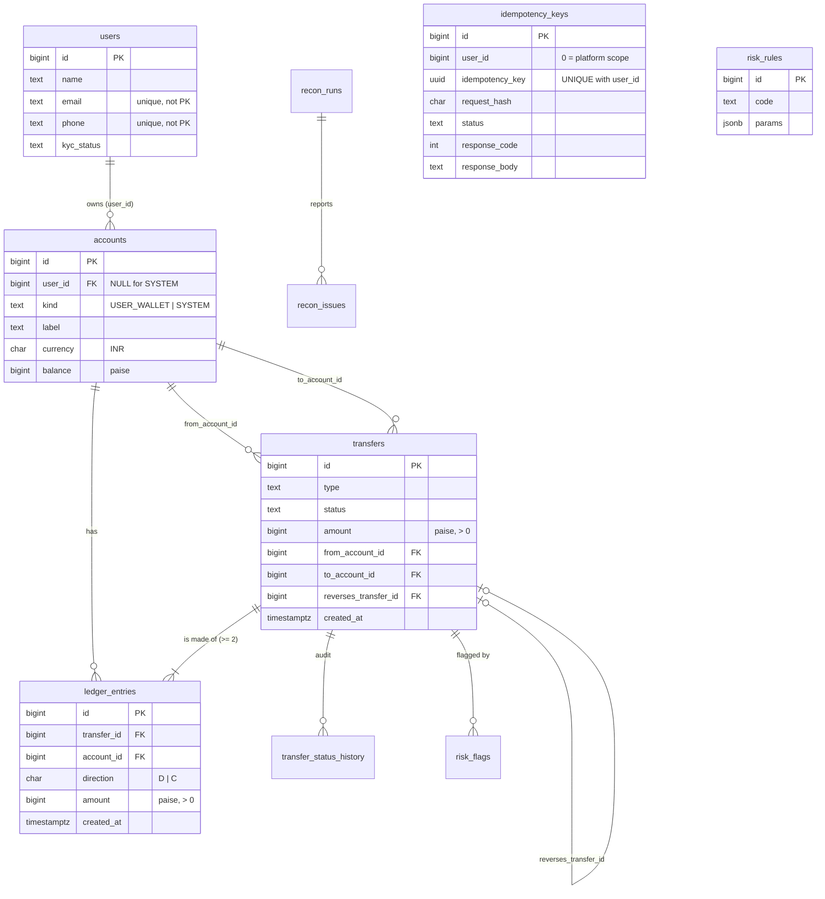

# Schema design (Milestone 1)

Migrations: `src/main/resources/db/migration/V1..V3` (Flyway, run automatically on startup, build the whole schema from an empty database).

## 1. Noun list: what became a table, and why

| Noun in the requirements | Table? | Why |
|---|---|---|
| user | **`users`** | We store name, email, phone, KYC status about them. |
| KYC status | column | One value per user, no extra data about it. |
| wallet | **`accounts`** (`kind='USER_WALLET'`) | Has a currency, a balance, a label, an owner. |
| system account (cash-in / cash-out / fee revenue) | **`accounts`** (`kind='SYSTEM'`) | Same behaviour as a wallet in the ledger; owned by nobody. |
| currency | column | INR only. A `currencies` table would hold nothing. A CHECK pins it. |
| transfer | **`transfers`** | The business event: type, status, amount, time, optional pointer to the transfer it reverses. |
| transfer type / status | columns with CHECK | Closed lists, no attributes of their own. |
| ledger entry | **`ledger_entries`** | One debit or credit line on one account; many per transfer. |
| balance | column on `accounts` | Derived, see the trade-off below. |
| idempotency key | **`idempotency_keys`** | Has a user, hash, status, saved response. |
| audit log of status changes | **`transfer_status_history`** | Many rows per transfer: who, when, from, to. |
| fraud rule | **`risk_rules`** | Thresholds must live in data, not code. |
| flag | **`risk_flags`** | A rule firing on a transfer, plus the LLM explanation and label. |
| reconciliation run / problem | **`recon_runs`, `recon_issues`** | One row per run, one per problem found. |
| job lock | **`job_locks`** | One row per job to serialise runs. |
| statement | no table | A query over `ledger_entries`. |
| question / answer | no table | Computed per request; not stored. |
| email, phone, name | columns | Attributes of a user. |
| paise / rupee | no table | A unit of the BIGINT. |

## 2. Cardinality decisions

| Relationship | Cardinality | Where the foreign key lives |
|---|---|---|
| user → accounts | 1 : M (system accounts have no user, so 0..M) | `accounts.user_id` (nullable; a CHECK ties NULL to `kind='SYSTEM'`) |
| transfer → ledger_entries | 1 : M (at least 2) | `ledger_entries.transfer_id` |
| account → ledger_entries | 1 : M | `ledger_entries.account_id` |
| transfer → source / destination account | M : 1 each | `transfers.from_account_id`, `transfers.to_account_id` |
| transfer → reversal transfer | 1 : 0..1 | `transfers.reverses_transfer_id`, with a **unique partial index**, so a transfer is reversed at most once |
| transfer → status history | 1 : M | `transfer_status_history.transfer_id` |
| transfer → risk flags | 1 : M | `risk_flags.transfer_id` |
| recon run → issues | 1 : M | `recon_issues.run_id` |
| user ↔ wallet is M:N? | No. A wallet has exactly one owner, so no mapping table. | |

No M:N relationship exists in the requirements, so no mapping table is needed.

## 3. ER diagram

## 4. Money conventions

* Whole **paise** in `BIGINT`. No floats anywhere.
* **Positive amount + direction (`D`/`C`)** rather than signed amounts. A CHECK `amount > 0` rejects zero and negative values outright, a sign mistake cannot silently turn a debit into a credit, and the debit-vs-credit split reads naturally in a statement. The cost is a `CASE` when summing. Signed amounts would make `SUM(amount)` trivially zero per transfer but let a wrong sign slip through unnoticed.
* **Balance of an account = credits − debits.** Topping up: debit `CASH_IN` (goes negative, allowed), credit the wallet.

## 5. What the database enforces itself

| Rule | Mechanism |
|---|---|
| Amounts are positive | `CHECK (amount > 0)` on `ledger_entries` and `transfers` |
| User wallet never below zero | `CHECK (kind = 'SYSTEM' OR balance >= 0)` (`accounts_no_overdraft_ck`). System accounts may go negative. |
| Wallets have an owner, system accounts don't | `accounts_owner_ck` |
| INR only | `CHECK (currency = 'INR')` |
| Entries are never updated, deleted or truncated | `BEFORE UPDATE OR DELETE` row trigger and `BEFORE TRUNCATE` trigger raise an exception |
| Debits = credits per transfer | **Deferred constraint trigger** `trg_transfer_balanced`, checked at COMMIT, so an unbalanced transfer cannot be committed even by buggy code |
| One reversal per transfer | unique partial index on `reverses_transfer_id`; `type='REVERSAL'` iff `reverses_transfer_id IS NOT NULL` |
| Idempotency key unique per user | `UNIQUE (user_id, idempotency_key)` |
| One label per wallet per user | unique partial indexes on `accounts` |

> In production run the app as a role that has only `INSERT`/`SELECT` on `ledger_entries` (`REVOKE UPDATE, DELETE`) and keep migrations on a separate owner role, so even a compromised app cannot disable the triggers. The compose file uses one role for simplicity, and the tests disable the trigger on purpose to simulate corruption.

## 6. Indexes (each one slows writes, so each has a named reason)

| Index | Serves |
|---|---|
| `ledger_entries (account_id, created_at DESC, id DESC)` | Statement, `WHERE account_id=? ORDER BY created_at DESC, id DESC`; also keyset pagination. **Costs one extra index write on every entry**, which is the hottest insert path. |
| `ledger_entries (transfer_id)` | Per-transfer balance check, `GET /transfers/{id}`, orphan check |
| `transfers (from_account_id, created_at DESC) INCLUDE (amount)` | Velocity and amount-spike rules (index-only scans); Q&A |
| `transfers (from_account_id, to_account_id)` | New-payee rule |
| `transfers (id) WHERE status='HELD'` | Admin queue. Partial, so it stays tiny |
| `transfers (reverses_transfer_id) WHERE NOT NULL` (unique) | One reversal per transfer |
| `users (lower(email))`, `users (phone)` | Uniqueness |
| `idempotency_keys (created_at)` | 24-hour cleanup |
| `risk_flags (created_at) WHERE llm_label IS NULL` | Nightly explain step |

Deliberately **not** indexed: `ledger_entries.created_at` alone (nothing queries by time across all accounts, and the nightly job full-scans anyway).

## 7. Design questions

**Do you store each account's balance, compute it from entries, or both?**
Both. The ledger is the source of truth and `accounts.balance` is a cached running total updated in the same transaction as the entries.
* *Stored only* would be cheap to read but unauditable: nothing proves it is right.
* *Computed only* is always right but every balance read and every funds check has to `SUM` the whole entry history of the wallet, which gets slower as the wallet ages. It is also hard to enforce "never below zero" with a simple CHECK.
* *Both* costs a second write per leg and the risk of the two drifting apart, which is exactly what the nightly reconciliation check #3 detects. In return the funds check is a single row read under the row lock, and the CHECK constraint is a hard backstop.

**Why store user wallets and system accounts in the same table?**
The ledger only cares that an entry hits an *account*. With one table, `ledger_entries.account_id` is a single foreign key, one transfer code path moves money between any two accounts (top-up is just CASH_IN → wallet), reconciliation sums one table, and adding a new system account (e.g. a tax account) is a row, not a schema change. The differences (owner, overdraft rule) are expressed as `kind` plus CHECKs.

**Which columns hold data you don't control, and why is none a primary key?**
`email`, `phone` and `name` come from users: they change (people change numbers), get recycled by operators, can be mistyped, and are not guaranteed unique forever. A primary key is copied into every foreign key and must never change, so it is a system-generated `BIGINT identity`. Email and phone get unique indexes for the business rule only. `transfers.note` and the idempotency key are also client-controlled, so they are never trusted as identifiers.
